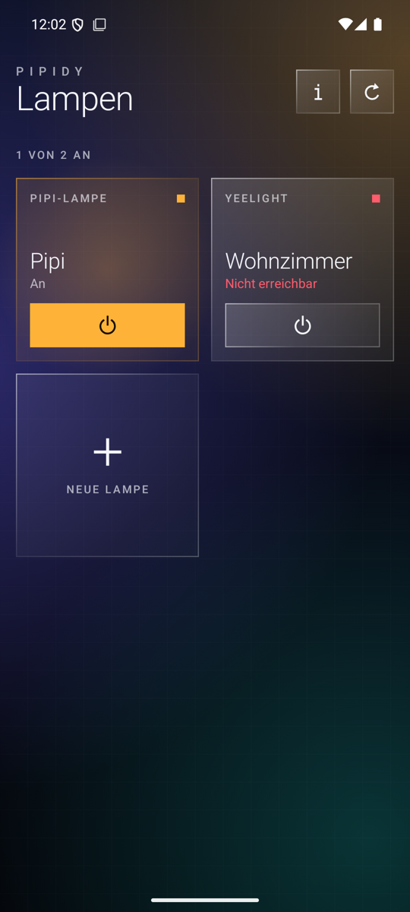
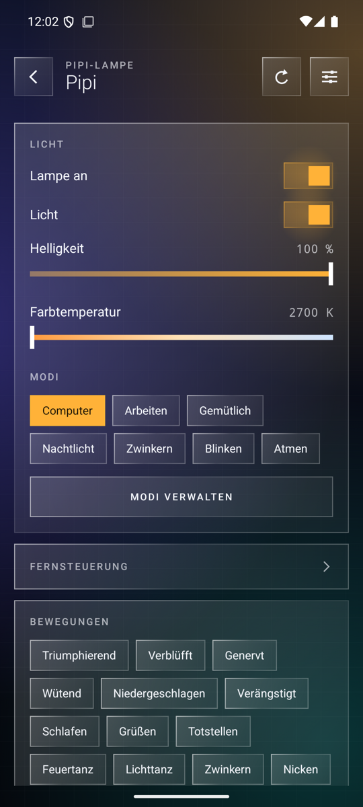
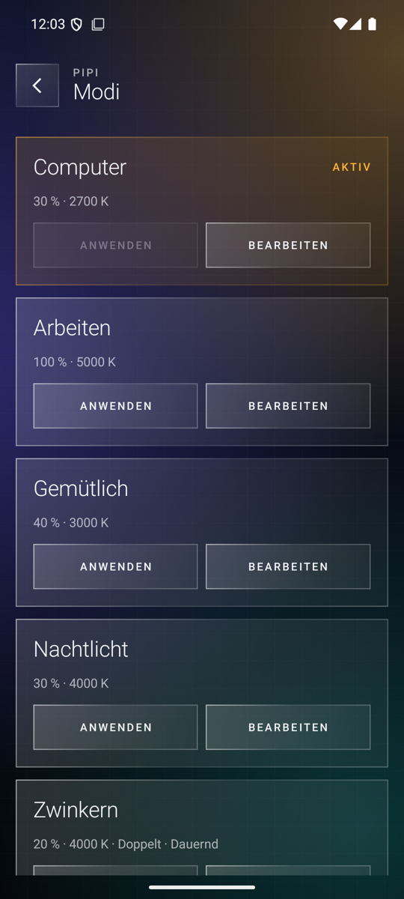
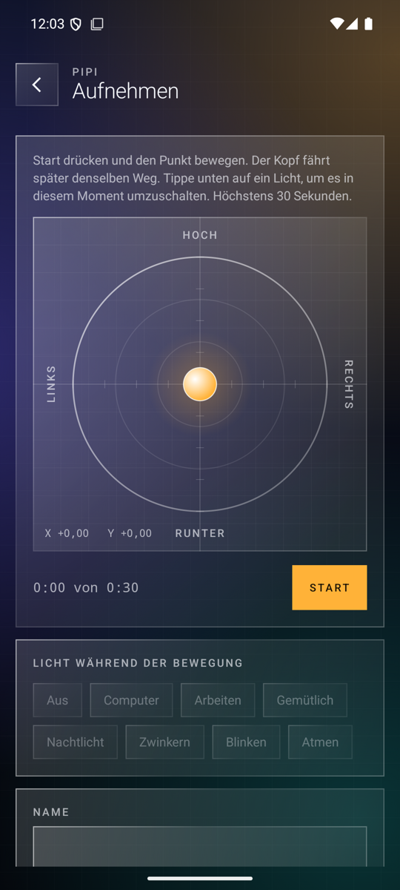
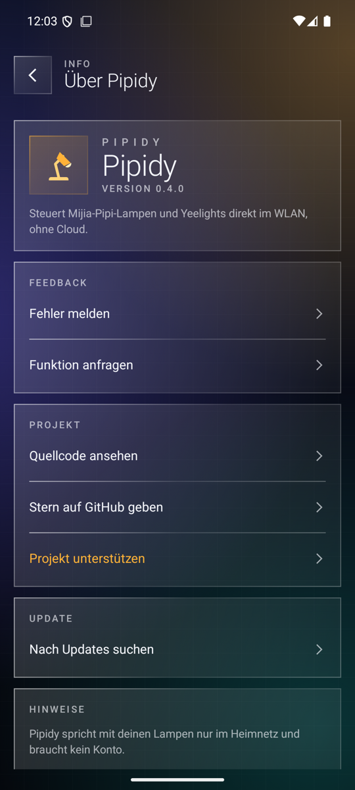

# Pipidy

🇬🇧 [English](#english) · 🇩🇪 **Deutsch**

  
  
  
  
  

Android-App für die Mijia-Pipi-Lampe (`dreame.light.r2229`) und Yeelight-Lampen. Sie spricht direkt im WLAN mit den Lampen, ohne Cloud und ohne Konto. Deutsch und Englisch, je nach Systemsprache.

**Download:** [neuestes Release](https://github.com/Glenn-Dandy/Pipidy/releases/latest)

**Pipi-Lampe:** Licht und Lichtmodi (auch eigene mit Blinken), Bewegungen und selbst aufgenommene Bewegungen, Fernsteuerung des Kopfes, Charakter, Interaktion, Ausschalt-Timer und Zeitpläne. Damit ersetzt Pipidy die Mi-Home-App bis auf Firmware-Updates, Automationen und Sprachsteuerung. Zeitpläne laufen nur, wenn die Lampe die Uhrzeit kennt, ohne Internet also nur mit einem Zeitserver im eigenen Netz. Die Lampe muss einmal in Mi Home hinzugefügt werden, danach läuft sie ohne Internet. Den Token liefert der [Xiaomi Cloud Tokens Extractor](https://github.com/PiotrMachowski/Xiaomi-cloud-tokens-extractor).

**Yeelight:** An und aus, Helligkeit, Farbtemperatur, Farbe, Suche im WLAN. Die LAN-Steuerung muss an sein.

`tools/lampe_offline.py` richtet eine zurückgesetzte Yeelight ganz ohne Cloud ein: Token lesen, LAN-Steuerung einschalten, WLAN setzen. Bei einer gebundenen Pipi-Lampe liest es den Token aus. Braucht Python mit `cryptography`.

Pipidy gehört nicht zu Xiaomi, Dreame oder Yeelight. Lizenz: MIT.

---

## English

Android app for the Mijia Pipi lamp (`dreame.light.r2229`) and Yeelight lamps. It talks to the lamps directly in your Wi-Fi, without a cloud and without an account. English and German, following the system language.

**Download:** [latest release](https://github.com/Glenn-Dandy/Pipidy/releases/latest)

**Pipi lamp:** light and light modes (including your own with blinking), motions and motions you record yourself, remote control of the head, character, interaction, sleep timer and schedules. That covers everything of the Mi Home app except firmware updates, automations and voice control. Schedules only run when the lamp knows the time, so without internet it needs a time server in your own network. The lamp has to be added to Mi Home once, after that it works without internet. The [Xiaomi Cloud Tokens Extractor](https://github.com/PiotrMachowski/Xiaomi-cloud-tokens-extractor) gives you its token.

**Yeelight:** on and off, brightness, colour temperature, colour, Wi-Fi search. LAN control has to be on.

`tools/lampe_offline.py` sets up a reset Yeelight with no cloud at all: it reads the token, switches LAN control on and sets the Wi-Fi. For a bound Pipi lamp it reads the token. Needs Python with `cryptography`.

Pipidy is not affiliated with Xiaomi, Dreame or Yeelight. License: MIT.
